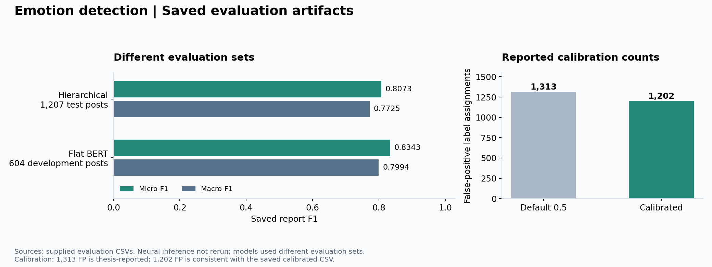
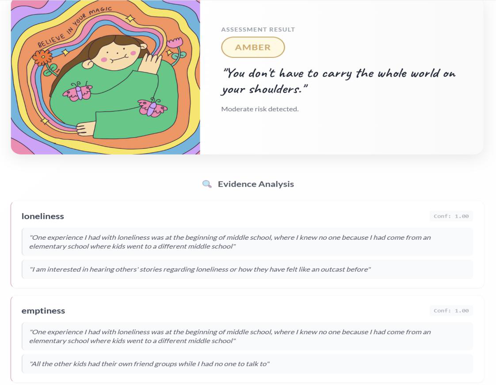
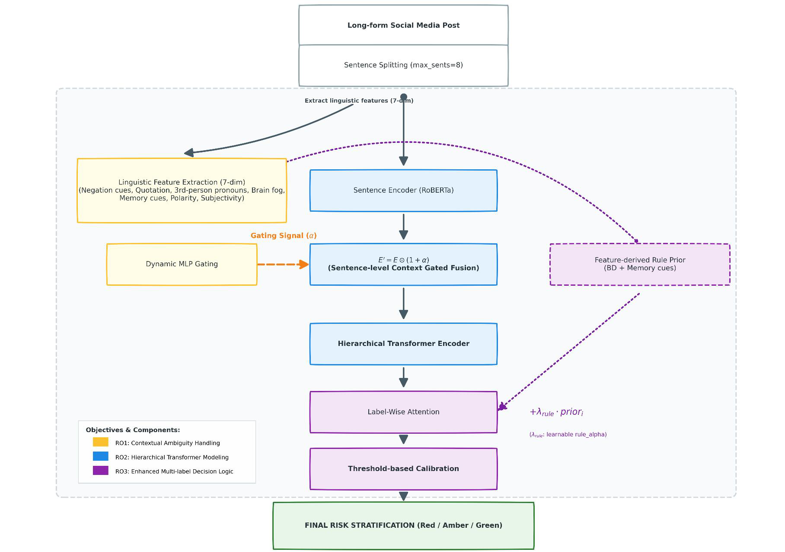

# 基于上下文门控与分层 Transformer 的多标签情绪识别

**自然语言处理研究作品集｜毕业设计｜八标签情绪识别**

本项目面向英文社交媒体长帖，使用预训练 RoBERTa、上下文门控和文档级 Transformer，识别八类与抑郁相关的情绪，并展示句子级预测证据。研究重点包括长文本建模、上下文特征、多标签分类和决策阈值校准。

项目使用编码器模型进行文本分类，不涉及生成式问答。



*模型分数来自原始评估 CSV。两个神经网络模型的评估样本不同，不能据此直接判断模型优劣。校准前的 1,313 次误报来自论文记录；校准后的 1,202 次与分层模型 CSV 的汇总指标一致。*

## 原型界面与模型架构

以下图片直接提取自毕业论文，展示原始 **MindSight 研究原型**。它们不是本仓库数值演示程序的截图。本次发布未包含原始应用源码和训练权重。

### 系统界面


*来源：论文第 62 页，图 4.6。界面包含文本输入、证据句数量控制、评估面板和证据句。顶部绿色横幅属于风险等级介绍轮播；该示例的实际预测是评估面板中的红色标记。*

### 预测结果与证据句



*来源：论文第 63 页，图 4.7。截图显示黄色（Amber）研究分级，以及孤独感、空虚感等标签的证据句。原图包含少量示例文本片段，没有展示原帖用户名或帖子编号。“Conf” 数值按论文原图保留，其概率校准情况未经过独立验证。*

### 模型架构



*来源：论文第 30 页，图 3.1。模型将句子编码与七维语言特征结合，经过上下文门控、分层聚合、标签级注意力和阈值校准，输出情绪标签与研究分级。*

## 核心方法

- 清洗英文社交媒体文本，将帖子切分为句子序列。
- 使用 RoBERTa-base 编码，每篇最多处理 **8 个句子，每句 64 个 token**。
- 提取 **7 类上下文特征**：否定、引用、第三人称代词、认知线索、记忆线索、情感极性和主观性。
- 使用 **2 层、8 个注意力头的 Transformer** 聚合句子表示，通过标签级注意力完成预测和证据句排序。
- 在验证集上为每个标签单独选择决策阈值。
- 将预测映射为红色、黄色、绿色三类研究分级。

## 数据核对与预处理

原始文件包含 **4,225 条训练样本、906 条验证样本和 906 条测试样本**，共 **6,037 条帖子**。文件后缀虽然是 `.json`，实际采用 JSON Lines 格式。本地核对未发现空文本、未知标签或 `label_id` 不一致。原始训练集中有 4 条重复文本的冗余记录；另有 2 种文本同时出现在原始训练集和测试集中，但帖子编号不同。

恢复的分层模型 notebook 记录了实验处理方式：清洗后保留 **6,032 条帖子**，使用随机种子 123 进行分层划分，得到 **3,860 条训练样本、965 条验证样本和 1,207 条测试样本**。本地执行该预处理后，复现了这些样本数量、标签分布，以及测试集中的 **4,425 次正标签标注**。一条帖子可以具有多个标签，因此标签总数可以大于帖子数量。

原始文件中的 906 条测试样本与实验使用的 1,207 条测试样本属于不同阶段。本次整理已运行预处理，尚未重新运行神经模型训练与预测。详见[数据核对说明](docs/DATA.md)。

## 原实验评估结果

仓库包含分层模型和 Flat BERT 的原始评估 CSV，以及八标签阈值文件。已核对标签顺序、各标签指标和汇总指标的内部一致性。以下为**原实验保存的结果**，尚未通过重新加载权重并执行预测来复现；当前未取得权重文件本身及逐样本预测概率。

| 原始评估报告 | Micro-F1 | Macro-F1 | notebook 记录的评估样本数 |
|---|---:|---:|---:|
| 分层 Transformer | 0.8073 | 0.7725 | 1,207 |
| Flat BERT | 0.8343 | 0.7994 | 604，该样本集也用于选择训练轮次 |

分层模型报告中的正标签总数为 4,425，各标签正样本数均与恢复后的测试集一致。“自杀意图”（Suicide Intent）标签的精确率、召回率和 F1 分别为 **0.7507 / 0.8490 / 0.7969**。Flat BERT 报告包含 2,260 次正标签标注，其指标与训练日志中 Micro-F1 最佳轮次一致。

由于评估样本不同，且 Flat BERT 使用上述 604 条样本选择训练轮次，这些分数不能作为受控对比来证明模型优劣。仓库中的基线 notebook 已改为使用共同的数据划分，供后续重新实验。

本页以原始 CSV 为准。论文中的 Macro-F1 为分层模型 0.773、Flat BERT 0.802，与保存的报告存在差异。论文原表保留在 `results/thesis_reported.json`；Flat BERT 的 0.802 出现在另一个训练轮次。详见[实验文件核对说明](docs/ARTIFACTS.md)。

### 本地重新运行的传统模型

整理后的传统基线代码已在 **3,860 条训练样本和 1,207 条测试样本**上运行。以下为本次新运行结果，与论文原始实验记录分开保存：

| 模型 | Micro-F1 | Macro-F1 |
|---|---:|---:|
| TF-IDF + 朴素贝叶斯 | 0.6697 | 0.4557 |
| TF-IDF + 逻辑回归 | 0.7308 | 0.6959 |
| TF-IDF + 支持向量机（SVM） | 0.7261 | 0.6790 |

完整指标和环境版本见 `results/shared_split_traditional_metrics.csv` 与 `results/shared_split_traditional_run.json`。神经模型仍需在相同划分下重新训练，才能与这些新结果进行受控对比。

### 阈值校准结果

| 决策指标 | 默认阈值 0.5 | 校准后阈值 |
|---|---:|---:|
| 标签误报次数 | 1,313 | 1,202 |
| 微平均精确率（Micro precision） | 0.7450 | 0.7601 |
| 宏平均精确率（Macro precision） | 0.7109 | 0.7284 |
| 汉明损失（Hamming loss） | 0.1970 | 0.1883 |

论文记录显示，标签误报次数下降 **8.45%**。根据校准后 CSV 的精确率、召回率和正样本数，可以推算出 **1,202** 次误报；校准前的 1,313 次仍以论文为来源。这里统计的是标签误报次数，不是误判帖子数。当前未取得逐样本预测数组，尚不能从原始预测重新计算全部校准结果。

## 仓库内容与验证状态

| 材料 | 当前状态 |
|---|---|
| 研究方法与结果 | 根据毕业论文和答辩幻灯片整理 |
| 原始数据核对 | 已检查样本数、标签一致性与文本重复，保留汇总报告 |
| 恢复的预处理流程 | 已在本地运行：清洗后 6,032 条，划分为 3,860 / 965 / 1,207 |
| 原型截图与架构图 | 提取自论文第 30、62、63 页，用于展示原项目 |
| 阈值、指标和分级工具 | 为本作品集新增，已通过合成测试数据验证 |
| 合成数值演示 | 仅需 Python 标准库，无需模型或数据集 |
| 分层模型训练代码 | 从原项目核心 notebook 恢复，主流程见 `notebooks/model.ipynb` |
| 传统基线 notebook | 已适配共同划分，代码已在本地执行，汇总指标已保存 |
| Flat BERT notebook | 已适配共同划分与验证集选模，尚未重新运行神经模型训练 |
| 原始评估报告 | 以汇总 CSV 形式保留，已核对内部一致性 |
| 原始校准阈值 | 保存在 `artifacts/thresholds.json`，保留原始浮点数值 |
| 模型权重与原始预测 | 未包含；权重与阈值的对应关系、神经模型预测尚未独立验证 |
| 在线模型服务 | 未包含 |

独立的决策工具是整理作品集时新增的代码；训练 notebook 则从原项目文件恢复。最初提供的 `bert.py`、`analysis.py` 和数据集 README 属于上游参考材料，不作为分层模型的原创源码展示。详见[材料来源与代码整理说明](docs/PROVENANCE.md)。

保存的阈值属于原实验。重新训练后，应使用新模型在验证集上重新选择阈值，不能将归档阈值直接用于任意新权重。

## 运行训练流程

将获授权使用的原始数据放在本地 `Dataset` 目录，再在独立环境下执行：

```bash
python -m pip install -r requirements-training.txt
python scripts/prepare_experiment.py Dataset
jupyter lab
```

使用新的内核打开 `notebooks/model.ipynb`，按顺序运行。两个基线 notebook 读取相同的预处理文件；Flat BERT 使用验证集选择权重，再在测试集上评估。

依赖列表不是原实验的环境锁定文件。目前已运行预处理与传统基线代码，并对 notebook 源码进行静态检查；尚未重新验证神经模型训练、推理和历史分数。详见[notebook 使用说明](docs/NOTEBOOKS.md)。

## 运行数值演示

需要 Python 3.10 或以上版本，无需安装第三方依赖：

```bash
python -m emotion_portfolio.demo
python -m unittest discover -s tests -v
```

该演示使用**人为构造的概率和标签**，展示阈值选择、指标计算和研究分级。它不接收用户文本，也不执行模型推理；演示输出与论文分数无关。

处理真实模型预测时，应仅使用验证集标签和概率选择阈值，固定阈值后，再在独立测试集上评估。标签顺序定义在 `emotion_portfolio/decision.py`。详见[方法说明](docs/METHOD.md)和[评估说明](docs/EVALUATION.md)。

## 文件说明

- `emotion_portfolio/decision.py`：输入检查、阈值选择和研究分级。
- `emotion_portfolio/metrics.py`：无需第三方依赖的多标签指标计算。
- `emotion_portfolio/demo.py`：合成数值演示。
- `results/thesis_reported.json`：标明来源的论文原始结果。
- `results/data_audit.json`：原始数据的汇总核对报告。
- `scripts/audit_dataset.py`：可重复运行的 JSON / JSON Lines 数据核对脚本。
- `scripts/prepare_experiment.py`：恢复的文本清洗与实验数据划分流程。
- `notebooks/`：分层模型、传统模型与 Flat BERT 的训练流程。
- `results/recovered_preprocessing.json`：本地执行预处理后的统计结果。
- `results/notebook_audit.json`：原始 notebook 日志的汇总核对记录。
- `results/shared_split_traditional_*`：本次重新运行的传统模型指标与环境信息。
- `results/original_*_performance.csv`：原实验保存的神经模型评估报告。
- `artifacts/thresholds.json`：原实验八标签阈值，不包含权重。
- `scripts/verify_saved_reports.py`：报告与阈值的一致性核对脚本。
- `assets/reported_results.png`：原实验结果图。
- `assets/thesis_*.png`：从论文提取的原型截图和架构图。
- `docs/`：方法、材料来源、评估限制与模型说明。
- `tests/`：阈值边界情况、指标计算和分级优先规则的测试。

## 数据来源与使用范围

DepressionEmo 包含 **6,037 条 Reddit 帖子**和八类情绪标签。数据集由 Rahman 等人（2024）发布，本项目未自行采集或标注这些数据。仓库不分发原始数据和训练权重。论文截图包含少量示例文本片段，仅用于展示项目，并非数据集发布。

根据上游仓库条款，将该数据集用于网页应用、移动应用或商业工具前，需要取得书面许可。本仓库用于研究作品展示和代码演示。红、黄、绿分级不构成临床评估；注意力排序仅反映模型关注位置，不能证明因果解释。

## 参考资料

- Rahman 等人（2024），*DepressionEmo: A novel dataset for multilabel classification of depression emotions*。[期刊 DOI](https://doi.org/10.1016/j.jad.2024.08.013)、[预印本](https://arxiv.org/abs/2401.04655)、[数据集与使用条款](https://github.com/abuBakarSiddiqurRahman/DepressionEmo)。
- [RoBERTa-base 模型说明](https://huggingface.co/FacebookAI/roberta-base)。
- 项目材料：毕业论文 *Depression-Related Emotion Multi-Label Detection on Long Social Media Posts using Transformer* 及答辩幻灯片。公开作品集中已省略个人身份信息和原始文件名，材料位置见 `docs/PROVENANCE.md`。

数据集、预训练模型及第三方材料保留各自的使用条款。本仓库不授予这些第三方材料的使用许可。
