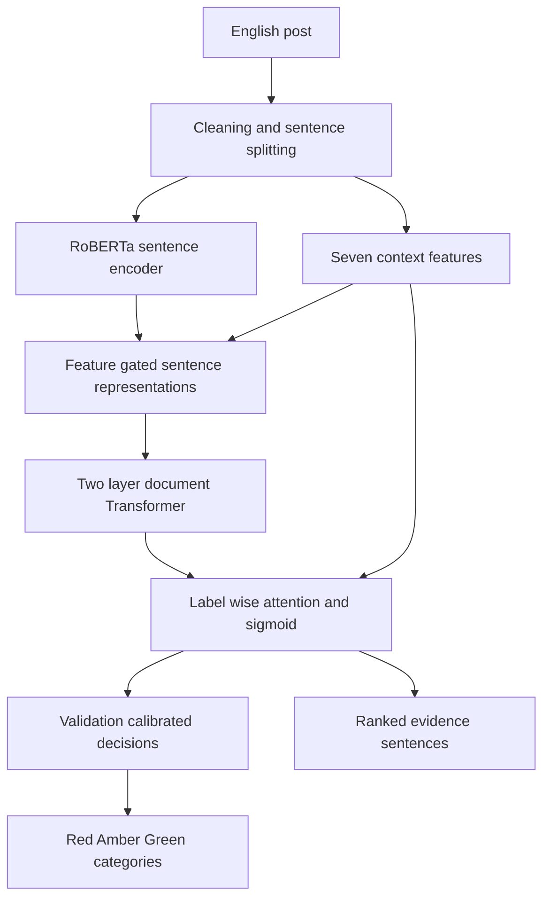

# Method

## Research question

Can sentence structure, explicit context cues and validation-based thresholds make eight-label emotion predictions easier to inspect and control?

## Architecture described in the dissertation

The seven features are negation, quotation, third-person pronouns, cognitive cues, memory cues, TextBlob polarity normalized to [0, 1], and TextBlob subjectivity.

The gate is Linear(7,16), LayerNorm, ReLU, Dropout(0.5), Linear(16,1), Sigmoid. Sentence vectors are multiplied by **1 + gate**. This factor lies between 1 and 2; it does not directly attenuate a vector below its original magnitude. The paper's language about suppression should therefore be understood cautiously. Relative attention and downstream transformations can change emphasis, but a negation-removal effect is not isolated by ablation.

The sentence encoder has hidden size 768. The document aggregator uses two Transformer encoder layers, eight heads, GELU and dropout 0.1, with positional encoding. A trainable scalar initialized to 0.5 controls a cognitive/memory prior added to the attention score of the Brain Dysfunction label. Label-wise weighted sentence representations feed independent sigmoid outputs.

Training settings reported in the dissertation: seed 123, up to 20 epochs, batch size 4, gradient accumulation 4, AdamW with weight decay 0.01, encoder learning rate 2e-5 and new-module rate 5e-5, warmup ratio 0.1, gradient clipping 1.0, early-stopping patience 4. The reported asymmetric loss uses positive focusing 0 and negative focusing 4.

## Calibration

Search thresholds 0.05 through 0.95 at 0.01 increments on validation data. For ordinary labels, maximize F1. For Suicide Intent, retain precision-feasible candidates (precision ≥ 0.70), maximize recall and break recall ties with F1. Fall back to maximum F1 if no candidate meets the precision floor. A target recall of 0.85 is a reference, not a hard constraint.

The portfolio code makes exact threshold ties deterministic and explicitly handles labels with no validation positives. These robustness choices are newly documented implementation details, not experimental contributions from the thesis.

## Priority cascade

Red: Suicide Intent reaches its threshold. Otherwise Amber: at least one of **Hopelessness, Worthlessness or Sadness** reaches its threshold. Otherwise Green. Loneliness and Emptiness are included in emotion prediction but are not Amber triggers in the appendix's implementation (p. 88). Equality uses `>=`.

## Interpretation limits

The recovered `HierDataset` samples eight positions across the post if it exceeds eight sentences; each retained sentence is truncated to 64 tokens. The original single-text evidence function keeps the first eight sentences. The public notebook aligns that function to the dataset's sampling for future use; this correction does not reproduce historical predictions. See `NOTEBOOKS.md`. Important content may still be dropped. The method does not solve unrestricted long-context processing. The dataset is mostly short to medium length: 99.16% of posts are within 256 RoBERTa tokens, according to the dissertation. Attention is an evidence-ranking aid, not a verified causal explanation.
